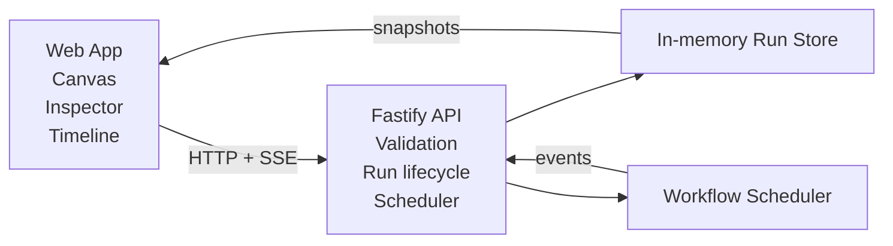

# FlowTrace Architecture

## 1. Purpose and scope

FlowTrace is a compact workflow editor and execution inspector designed as a take-home engineering assessment. It demonstrates four core ideas in one product:

- graph authoring in the browser
- workflow validation before execution
- DAG execution with concurrency and cancellation
- live runtime inspection through an event stream

The implementation is intentionally small and inspectable. It is built to be easy to reason about in a single session rather than to mimic a distributed production orchestration system.

## 2. System overview

FlowTrace is split into two runtime boundaries:

- frontend: React + TypeScript + Vite + React Flow + Zustand
- backend: Fastify + TypeScript + Zod

The frontend handles authoring, editing, and visual inspection. The backend owns validation, run creation, DAG scheduling, SSE delivery, and in-memory run state.



## 3. Core design principles

### Editor state and runtime state are separate

The app keeps graph editing and execution state in separate stores.

- editor state controls node creation, edge creation, selection, and validation feedback
- execution state tracks runs, ordered events, node health, and terminal status

This separation is what allows a user to edit a workflow while a run is queued or executing without corrupting the authoring model.

### Validation is server-authoritative

The workflow schema and validation logic live in the API layer. The frontend can enforce UI feedback, but the backend is the actual gate for invalid workflows. The run creation endpoint refuses invalid graphs before any execution work begins.

### Execution is a simplified DAG engine

The scheduler is intentionally narrow: it explores a directed acyclic graph, runs ready nodes when dependencies succeed, and skips downstream work when upstream dependencies fail. It is not a general workflow orchestrator or message bus.

### Observability is event-first

Every lifecycle change is emitted as an ordered event. The frontend replays those events and rebuilds node status from the event stream. This gives the UI a consistent, inspectable runtime model even when reconnecting or replaying.

## 4. Frontend architecture

### App shell

The root app composes the key views:

- toolbar for node creation
- canvas surface for graph editing
- inspector for selected node or edge details
- timeline for run activity
- status footer for the active run state

The main orchestration of run start, cancel, import, export, and sample loading lives in the web app shell rather than in a separate page router.

### State management

The frontend uses Zustand for local state management.

- graph state: nodes, edges, selection, validation messages, and edge-creation rules
- execution state: run id, ordered events, node states, stream cursor, and terminal status

This keeps the code easy to reason about and keeps the runtime data flow explicit.

### Visual model

Nodes are rendered with React Flow. Each node has a kind (input, transform, output), editable metadata, and execution-specific status overlays. Edges can carry labels and comments to represent branch conditions or notes; this is important for example workflows that need to read like operational logic rather than abstract graphs.

## 5. Backend architecture

### API entrypoint

The Fastify app exposes the major workflow and run routes:

- health
- workflow validation
- run creation
- run listing
- run snapshot retrieval
- event replay
- SSE stream
- run cancellation

It also maintains an in-memory run store keyed by run id and an event history capped to a maximum number of entries.

### Workflow validation contract

Validation is enforced in the API and returns a result shaped like:

- valid
- errors
- warnings

The implementation checks for:

- empty or invalid IDs
- too many nodes
- duplicate nodes
- duplicate edges
- missing node references
- invalid edge direction for input/output nodes
- cycles in the directed graph

These checks are the guardrail that protects the scheduler from invalid graphs.

## 6. Execution model

### DAG scheduling

The scheduler transforms the workflow into adjacency maps and evaluates readiness from dependencies. A node is ready only when all of its upstream dependencies have succeeded.

The runtime behavior currently includes:

- concurrency limit for in-flight nodes
- node lifecycle events (`started`, `succeeded`, `failed`, `skipped`)
- overall run terminal states
- cancellation logic that aborts active work and prevents downstream progression

### Failure propagation

When a dependency fails, downstream nodes are not allowed to execute. They are marked as skipped, which preserves the clear cause-and-effect chain in the timeline and inspector.

This is a deliberate trade-off: it is deterministic and easy to debug, but it is not a full retry or compensation model.

## 7. Event streaming and replay

The backend emits ordered events as SSE frames. Each event has a sequence number and is used to support cursor-based replay and reconnect recovery.

The frontend rebuilds node state from a run’s event stream rather than a single snapshot alone. This gives the UI a way to recover from stale or replayed events, deduplicate duplicates, and render historical state in a stable way.

The event model includes:

- run-created
- run-started
- node-started
- node-succeeded
- node-failed
- node-skipped
- run-terminal
- run-cancelled

## 8. Directory structure

```text
apps/
  api/
    src/
      index.ts
      scheduler.ts
      workflow.ts
  web/
    src/
      App.tsx
      styles.css
      types.ts
      components/
      store/
      public/
```

The API and web app are intentionally contained and easy to inspect without a larger framework shell.

## 9. Important trade-offs

This project chooses simplicity over scale.

### Included by design

- local in-memory run state
- a single-process scheduler
- browser-only authoring state
- simple event replay and SSE delivery
- deterministic DAG progression

### Explicitly not included

- durable persistence across process restarts
- multi-user concurrency control
- distributed scheduling
- retries, compensation, or long-running orchestration
- authentication and per-user isolation

These are deliberate constraints for an assessment project and are not hidden assumptions.

## 10. Why this architecture works for the assessment

The architecture is intentionally narrow but correct for the problem statement:

- workflow edits are explicit and easy to validate
- execution behavior is deterministic and inspectable
- UI and backend responsibilities are cleanly separated
- the event stream makes the system explainable to a reviewer
- the execution model is simple enough to hold in memory and explain in a short review session

This makes it well-suited for a take-home assessment where the evaluator is looking for clarity, judgment, and implementation discipline rather than enterprise-grade scale.
