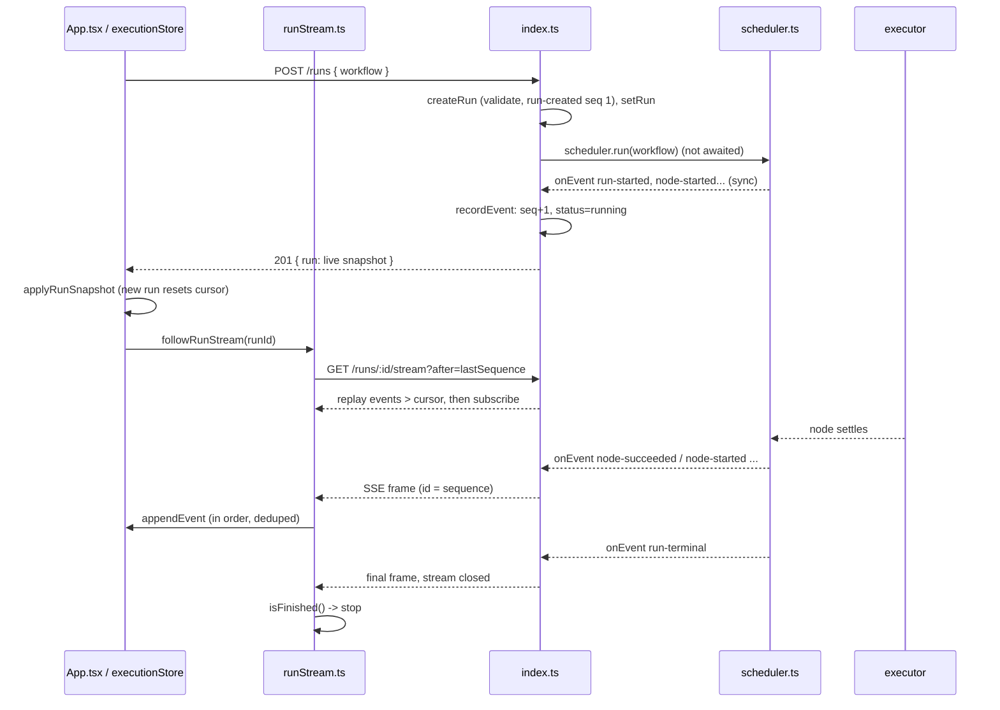

# FlowTrace Architecture

This document traces the execution lifecycle through the actual code. For each behavior it states which tests prove it and which parts are only inferred from reading the code. For setup and the API reference, see [README.md](README.md).

## 1. Scope

FlowTrace covers four things:

- authoring a DAG in the browser
- validating it on the server
- executing it with a real dependency-aware scheduler
- inspecting execution live through an ordered event stream

Node execution itself is simulated. Everything runs in one Node.js process with in-memory state.

## 2. Components

```text
apps/
  api/src/
    workflow.ts     Zod schemas, validateWorkflow, createRun, cancelRun (pure helper)
    scheduler.ts    createWorkflowScheduler: DAG scheduling, failure skipping, cancellation, onEvent
    index.ts        Fastify routes, in-memory run store, recordEvent, SSE fan-out
    testing.ts      createControlledExecutor (test helper)
  web/
    vite.config.ts            Dev and preview server; /api proxy to the Fastify API
    vite.proxy.test.ts        Real Vite dev server + stub API: route mapping, SSE pass-through
  web/src/
    App.tsx                   Studio shell; run, cancel, import/export, sample loading
    runStream.ts              followRunStream: SSE client with resume, retry, gap fill
    store/graphStore.ts       Editable graph + client-side connection rules
    store/executionStore.ts   Ordered event log, cursor, derived node states
    components/               Canvas node, timeline, inspector, toolbar
```

## 3. Core invariants

These invariants carry the design. Each one is enforced in one place.

1. **The event log is the source of truth.** The run status, `startedAt`, and `finishedAt` are derived when an event is appended (`recordEvent` in `index.ts`). On the client, node states are folded from events.
2. **Sequences are assigned once and never change.** `createRun` gives `run-created` sequence 1. `recordEvent` gives every later event `last + 1`. Nothing renumbers or re-sorts the log, so a cursor held by a client stays valid for the lifetime of the run.
3. **The scheduler reports events as they happen.** `onEvent` is called synchronously for each event, in order, so the server log never lags behind the scheduler.
4. **There is exactly one terminal event, and it is last.** The scheduler's `appendEvent` drops anything after `run-terminal`.
5. **The client applies events in order, each one once.** `followRunStream` delivers only `cursor + 1` (filling gaps from the replay endpoint). The execution store drops anything at or below `lastSequence`.

## 4. Lifecycle



### 4.1 Run

1. `handleRunWorkflow` in `App.tsx` sends `POST /runs` with the payload built by `buildWorkflowPayload`.
2. `createRun` validates the request with Zod and `validateWorkflow`. An invalid workflow returns 400 and nothing is scheduled.
3. The route calls `setRun(run)` and then `void startSchedulerForRun(run)`. The scheduler's `run()` executes synchronously up to its first `await`. That means `run-started` and the first `node-started` events are already recorded when the 201 response is serialized. The response returns `runs.get(id)`, the live snapshot.

**Proven:** `index.test.ts` ("records scheduler events as they happen…"), which asserts status `running` and `[run-created, run-started, node-started:input-1]` before any node finishes.

**Inferred:** the client side of this flow, because `App.tsx` has no test.

### 4.2 Execution events

1. The scheduler's `appendEvent` pushes to its local array and calls `config.onEvent`.
2. The server's `recordEvent` assigns the sequence, updates the status, and calls `setRun`.
3. `setRun` notifies the SSE listeners. Each open stream's `flushRunEvents` writes the frames after its own cursor.
4. On the client, `followRunStream` parses each frame, `deliver` checks ordering, and `appendEvent` folds the event into `nodeStates`. The canvas and the timeline re-render from the store.

**Proven:** `index.test.ts` ("streams each event over SSE before the run finishes") reads `node-started:input-1` from a real HTTP stream while that node is still running. It asserts that the terminal event has not arrived before the remaining nodes finish, and that the ids are contiguous. `executionStore.test.ts` checks that live events produce correct durations.

**Inferred:** that the canvas visibly updates in a browser. The SSE path through the Vite proxy is verified: `vite.proxy.test.ts` checks that frames are forwarded live, and a manual `curl` against the real API through the proxy received each event as it happened. But no browser session has been run.

### 4.3 Concurrent branches

`scheduleReadyNodes` selects `queued` nodes whose prerequisites have **all** `succeeded` and starts them while fewer than `maxConcurrency` nodes are active. The main loop awaits `Promise.race` over the active tasks, propagates skips, and schedules again. JavaScript runs single-threaded, and every status change happens synchronously between awaits, so nothing in this bookkeeping can race.

**Proven:** `scheduler.test.ts`:
- "runs independent ready nodes concurrently" reaches a peak of 2.
- "makes dependents wait for every prerequisite even when slots are free" uses `maxConcurrency: 4`. With prerequisites `a` and `b`, node `c` does not start after `a` finishes, only after `b`.

### 4.4 Failure

1. `settleNode` marks the node `failed` and emits `node-failed`.
2. `propagateBlockers` repeats until nothing changes. It skips any `queued` node with a prerequisite that ended without succeeding, even if its other prerequisites are still running.
3. The loop does **not** end the run on failure. It continues while any node is in flight, so independent branches finish. The terminal status (`failed`) is decided only after every task has settled.

**Proven:** `scheduler.test.ts`:
- "keeps running independent branches after a sibling fails": no terminal event is emitted while `slow` is still running, and `after-slow` later succeeds.
- "skips transitive dependents as soon as one prerequisite fails, regardless of node order": nodes are declared in reverse topological order. `join` is skipped while its other parent is still running.

### 4.5 Cancellation

1. `handleCancelWorkflow` sends `POST /runs/:id/cancel`.
2. The route parses `{ reason? }` and returns `cancelled: false` without changes if the run has already finished. Otherwise it calls `scheduler.cancel(reason)`.
3. `cancel()` sets `cancelRequested` and calls `cancelActiveRun`, which synchronously:
   - marks each running node `cancelled` and emits `node-skipped` with the reason,
   - aborts each node's `AbortController`,
   - emits `run-terminal: cancelled`.
4. `scheduleReadyNodes` refuses to start anything once cancel has been requested. Later executor results are ignored, because `settleNode` only acts on nodes that are still `running`.
5. `run()` still awaits the in-flight tasks before it resolves, so no promise is left orphaned.
6. If no scheduler is registered and the run is not finished (an edge case), the route records the terminal event itself.

**Proven:**
- `scheduler.test.ts`: "cancels in-flight nodes immediately and never starts new ones" (the events are present synchronously after `cancel()`, and only `a` and `b` ever start); "starts no nodes when cancelled before the run begins"; "interrupts the default executor when cancelled" (resolves in under 500 ms, against a 500–3000 ms node).
- `index.test.ts`: "cancels the real scheduler and keeps the history of nodes that ran", which checks the exact event list, and "treats cancelling a finished run as a no-op".

**Limits:**
- Cancellation is cooperative. An executor that ignores `AbortSignal` keeps running until it returns. Its result is discarded, but the work is not interrupted.
- In-flight nodes are reported with `node-skipped`, so the inspector shows "skipped" rather than "cancelled".
- Cancel through the Vite proxy was exercised with `curl` against the real API, but not by clicking Cancel in a browser.

### 4.6 Reconnection

On the server, `/stream` subscribes before it replays and does both synchronously, so no event can fall between the replay and the live push. The cursor comes from `?after=`, or from the `Last-Event-ID` header if no `after` is given.

On the client, `followRunStream`:

- reads `getCursor()` (the store's `lastSequence`) on every connect, never a stale React closure;
- after a disconnect, an error, or an unexpected end of stream, retries with backoff of `min(5000, 250 * 2^failures)` ms, so 0.5 s up to 5 s. It retries indefinitely and resets the counter after any connection that delivered events;
- when an event arrives with `sequence > cursor + 1`, fetches `/events?after=cursor` and applies the contiguous run first;
- stops on run completion, on abort, or on 404 (`not-found`; the UI shows a message and marks the run `failed`).

**Proven:**
- `runStream.test.ts`, with a fake `fetch` and SSE frames split across chunks: resuming from the last applied sequence after a dropped stream without duplicates; retrying after a network error; filling a gap; the 404 and abort outcomes.
- `index.test.ts`: "resumes from a cursor via ?after and Last-Event-ID without gaps or duplicates", against a real HTTP server.
- `executionStore.test.ts`: dropping stale events; resetting the cursor when a different run loads.

**Not proven, or missing:**
- Not tested end to end in a browser, and not tested against real network interruptions.
- There is no snapshot-based recovery. `GET /runs/:id` is never used by the client.
- A page reload loses track of the run.
- There is no "reconnecting" indicator in the UI.
- The client retries forever while the server is unreachable.

## 5. Design decisions and trade-offs

| Decision | Why | Cost |
|---|---|---|
| The scheduler emits events through a synchronous callback, and the server owns sequencing | One writer assigns sequences, so cursors are trivially stable | The scheduler is coupled to an in-process consumer; there is no queue between them |
| A failure skips dependents immediately instead of aborting the run | Independent branches finish; the cause of each skip is visible | A failed run takes as long as its slowest independent branch |
| Cancellation is synchronous inside the scheduler | The HTTP response already reflects the final cancelled state | It is cooperative; misbehaving executors are not interrupted |
| The client recovers by replaying events rather than fetching snapshots | One code path for live updates and recovery | No compact recovery for very long runs; needs the full log after the cursor |
| The SSE client uses `fetch` and `ReadableStream` rather than `EventSource` | Explicit control over the cursor, backoff, and abort | Reconnection is implemented by hand, not inherited from the browser |
| Everything is in memory in one process | Simple to trace and test | Not durable; no multi-instance support; runs are never evicted |

## 6. Known gaps

- **Same-origin API access:** the frontend calls `/api/*` on its own origin, and the Vite dev and preview proxy (`vite.config.ts`) forwards those requests to `http://127.0.0.1:3001` with the prefix removed. The API sends no CORS headers, so this works only behind a proxy. Any other way of hosting the static build must route `/api/*` the same way. This replaced the original design, in which the browser called `:3001` directly and every request failed CORS.
- **Branches:** edge labels and branches (`yes` / `no`) are editor-only. They are not sent to the API, and every outgoing edge executes.
- **Executor:** node execution is simulated, and node config and outputs are not modelled.
- **Concurrency:** fixed at 2 on the server.
- **Unused event type:** `run-cancelled` is defined in the schema but never emitted. `cancelRun` in `workflow.ts` is an exported, tested helper that the routes no longer use.
- **Event cap:** the log is capped at 1,000 events per run. That is unreachable at 50 nodes, but a client cursor older than the trimmed range would not be detected.

## 7. Scaling notes (not implemented)

- **Larger graphs:** both the server log and the client store copy the event array on each append. Batch updates and virtualize the timeline before raising the limits.
- **Durability:** persist the event log; `recordEvent` is the single place where an append would become a database write. On startup, recover or fail runs that were left in progress. Put the run id in the URL so a reload can reattach.
- **Multiple instances:** sequence assignment and SSE fan-out would need a shared log (for example a database or a stream such as Redis Streams) instead of the in-process `Map` and listener sets.
