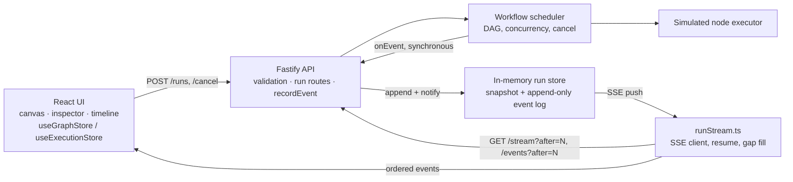

# FlowTrace

FlowTrace is a small workflow editor and execution inspector. A React + Vite frontend lets you build a DAG of input, transform, and output nodes. A Fastify backend validates the graph, runs it on a real dependency-aware scheduler, and streams every execution event to the browser over Server-Sent Events (SSE). Node execution is **simulated**: each node waits a random duration and may fail at random. Nodes do not process data.

This is an assessment-grade prototype, not a production orchestration platform. The [Known limitations](#11-current-limitations) section lists what does not work, including one gap that blocks the browser UI from starting runs today.

See [ARCHITECTURE.md](ARCHITECTURE.md) for the full execution lifecycle and [AI_NOTES.md](AI_NOTES.md) for how AI assistance was used and what it corrected.

## Status at a glance

| Area | State | Evidence |
|---|---|---|
| Workflow validation (API) | Works | `workflow.test.ts` |
| DAG scheduling, concurrency, failure skipping | Works | `scheduler.test.ts` (deterministic, controlled executors) |
| Live event recording and SSE delivery | Works | `index.test.ts` (real HTTP server) |
| Cancellation through the API | Works, with caveats ([§9](#9-cancellation-semantics)) | `scheduler.test.ts`, `index.test.ts` |
| Stream resume and reconnect (client) | Works in unit tests, not verified in a browser ([§8](#8-snapshot-replay-and-reconnection)) | `runStream.test.ts`, `executionStore.test.ts` |
| **Browser UI starting a run** | **Blocked: the API has no CORS support** ([§11](#11-current-limitations)) | Preflight `OPTIONS /runs` returns 404 |

## Stack

- React 18, TypeScript, Vite 5
- React Flow 11, Zustand 5
- Fastify 5, Zod 3
- Vitest 2

## Prerequisites

- Node.js 20+ (verified with Node.js 24.19)
- npm 10+

## Install dependencies

```bash
npm install
```

## Run the app

Start the API (port `3001`):

```bash
npm run dev:api
```

Start the web app (port `5173`):

```bash
npm run dev:web
```

> **Known issue:** the web app calls `http://localhost:3001` directly from origin `http://localhost:5173`. The API does not register CORS headers and has no `OPTIONS` routes, so the browser blocks `POST /runs`. The UI then shows the browser's fetch error and sets the status to `failed`. Editing, import, export, and the sample workflow all work. Starting a run from the UI does not. You can exercise the backend directly with `curl` or through the test suite.

## Useful scripts

```bash
npm run test       # web + api Vitest suites
npm run typecheck  # tsc --noEmit for both apps
npm run build      # vite build (web) + tsc (api)
```

## Architecture

### 1. Frontend components and responsibilities

`App.tsx` is the single studio shell. It composes the toolbar, the React Flow canvas, the node/edge inspector, and the execution timeline. It also owns run creation, cancellation, import/export, and sample loading. The SSE client lives in `runStream.ts`, separate from React, so it can be unit-tested.

### 2. Workflow editing state versus execution state

- `useGraphStore` holds the editable graph: nodes, edges, selection, validation messages, and client-side connection rules.
- `useExecutionStore` holds the selected run: its id, the ordered event list, `lastSequence` (the resume cursor), derived `nodeStates`, and the run status.

The graph can be edited while a run is in progress. The run executes the copy of the workflow that was sent when it started, so later edits do not affect it.

### 3. Workflow validation rules

`apps/api/src/workflow.ts` is the authority. `POST /runs` rejects invalid workflows with HTTP 400 before any scheduling starts. It checks:

- schema shape: bounded, non-empty ids and labels; node types `input`, `transform`, `output`
- at most 50 nodes (`MAX_WORKFLOW_NODES`)
- no duplicate node ids or duplicate `source->target` edges
- every edge references existing nodes
- input nodes have no incoming edges, and output nodes have no outgoing edges
- no directed cycles

Disconnected graphs are allowed. The editor applies similar connection rules locally, including cycle prevention, for immediate feedback. Imported JSON bypasses those editor checks and is only validated by the server when you run it. The UI never calls `POST /workflows/validate`.

### 4. Backend API contract

| Method & path | Behavior |
|---|---|
| `GET /health` | Service name and timestamp |
| `POST /workflows/validate` | `{ valid, errors, warnings }`; 400 when invalid |
| `POST /runs` | Body `{ workflow, metadata? }`. Validates, creates the run, and starts the scheduler. Returns 201 with the live snapshot. Because the scheduler starts synchronously, this already contains `run-created`, `run-started`, and the `node-started` events of the first ready nodes. |
| `GET /runs` | Summaries: id, status, workflowId, updatedAt |
| `GET /runs/:id` | Full run snapshot including its event log |
| `GET /runs/:id/events?after=N` | Events with sequence > N, plus `nextCursor`, `status`, and `total` |
| `GET /runs/:id/stream?after=N` | SSE: replays events after N (or after the `Last-Event-ID` header), then pushes new events live. The server closes the stream after the terminal event. |
| `POST /runs/:id/cancel` | Body `{ reason? }`. Cancels an active run and returns `{ run, cancelled: true }`. For a finished run it returns `{ run, cancelled: false }` and changes nothing. |

### 5. DAG execution model

`apps/api/src/scheduler.ts` builds an incoming-edge map and keeps a status per node: `queued`, `running`, `succeeded`, `failed`, `skipped`, or `cancelled`.

- A node starts only when **all** of its prerequisites have `succeeded`.
- At most `maxConcurrency` nodes run at once. The server uses the default of **2**, and the UI cannot change it.
- Each event is emitted through the `onEvent` callback the moment it happens. The server appends it to the run's event log immediately.
- The run ends `succeeded` only if every node succeeded. Otherwise it ends `failed` or `cancelled`. Every run emits exactly one `run-terminal` event, and it is the last event.

The default executor waits 500–3000 ms and fails 10% of the time. Node config (`expression`, `defaultValue`, `sink`) is not evaluated. **Edge labels and Yes/No branches are visual only.** They are not sent to the API, and the scheduler runs every outgoing edge, so both the "Yes" and the "No" path of the sample workflow execute.

### 6. Concurrency and failure propagation

- Independent ready nodes run concurrently, up to the concurrency limit.
- When a node fails, every node that depends on it is marked `skipped` immediately. This continues transitively, and it applies even if the dependent is also waiting on a branch that is still running.
- **A failure does not stop independent branches.** The scheduler keeps going until every in-flight node settles, then reports `failed`.

Tests cover each of these with a controlled executor whose nodes finish only when the test says so, so the outcomes do not depend on timing.

### 7. SSE event structure and sequence numbers

Each frame looks like this:

```text
id: 7
event: run
data: {"type":"node-succeeded","nodeId":"transform-1","timestamp":"...","id":7,"sequence":7,"runId":"run-..."}
```

Events emitted today: `run-created`, `run-started`, `node-started`, `node-succeeded`, `node-failed`, `node-skipped`, and `run-terminal` (`status`: `succeeded` | `failed` | `cancelled`). The schema also defines `run-cancelled`, but nothing emits it. Cancellation is reported as `run-terminal` with `status: "cancelled"`.

The server assigns each event's sequence number **once**, when it is appended (`recordEvent` in `index.ts`). Sequences start at 1, are contiguous per run, and are never renumbered, so a client cursor stays valid. The log is capped at 1,000 events per run. A 50-node run produces at most 103 events, so the cap is never reached.

### 8. Snapshot, replay and reconnection

Runs live in an in-memory `Map` inside the API process.

How the client (`followRunStream` in `runStream.ts`) recovers:

- Every connection opens `/stream?after=<lastSequence>`. The cursor is read from the execution store at connect time.
- If the connection drops or the network fails, the client retries with exponential backoff (0.5 s, 1 s, 2 s, 4 s, then 5 s), **indefinitely**, until the run finishes, the stream is aborted, or the server returns 404.
- If an event arrives ahead of the cursor, the client first fetches the missing range from `/events?after=<cursor>`, so the store only ever receives events in order and without gaps.
- The execution store ignores any event whose sequence is at or below `lastSequence`, which deduplicates replays. Loading a different run resets the cursor.

What is verified and what is not:

- **Tested** (`runStream.test.ts`, with a fake `fetch` and SSE chunks split mid-frame): resuming after a dropped stream without duplicates, retrying after a network error, filling a gap from the replay endpoint, stopping on 404, and stopping on abort.
- **Tested** (`index.test.ts`, against a real HTTP server): replay through `?after=` and through `Last-Event-ID`, with contiguous ids and no duplicates.
- **Not tested:** the `App.tsx` wiring in a real browser (blocked by the CORS gap) and real network interruptions.
- **No snapshot recovery path.** The client recovers by replaying events, never by fetching `GET /runs/:id`.
- **A page reload loses the run.** The selected run id is not persisted and the UI has no run picker.
- **No reconnect indicator.** While reconnecting, the UI only logs a console warning.
- **Server restart.** Runs are lost. The client gets a 404, stops, shows "This run no longer exists on the server", and marks the run `failed` locally.

### 9. Cancellation semantics

When a client calls `POST /runs/:id/cancel` on an active run, `scheduler.cancel(reason)` does the following synchronously, before the HTTP response is sent:

1. Marks every running node as cancelled and records a `node-skipped` event for it, with the cancel reason.
2. Aborts each running node's `AbortSignal`.
3. Records `run-terminal` with status `cancelled`.

No node starts after cancellation. The events of nodes that already ran stay in the history.

What cancellation does **not** guarantee:

- **It is cooperative.** The built-in simulated executor stops immediately when aborted (tested). An executor that ignores `AbortSignal` keeps running in the background until it returns. Its result is discarded, but the work is not interrupted.
- **Cancelled nodes appear as "skipped."** In-flight nodes are reported with a `node-skipped` event, so the inspector shows them as skipped rather than cancelled. There is no dedicated `node-cancelled` event.
- **A finished run cannot be cancelled.** Cancelling a run that has already finished is a no-op and keeps its real outcome.

### 10. The Execution Inspector

`useExecutionStore` folds events into `nodeStates`: status, `startedAt`, `finishedAt`, `durationMs`, and the error or skip reason. The canvas colors each node by that status. The timeline lists events in sequence order, and selecting an event or node shows its details in the inspector.

Nodes that have not run yet show as `queued`. The `output` field exists in the client types, but the API never sends output, so it is always empty.

### 11. Current limitations

Blocking:

- **No CORS on the API**, so the browser UI cannot start or cancel runs (see the [Run the app](#run-the-app) note). A Vite dev proxy or a CORS hook would fix this. Neither is implemented.

Behavioral:

- Node execution is simulated, and node config is ignored.
- Branch labels (Yes/No) do not affect execution. All outgoing edges run.
- Concurrency is fixed at 2.
- Cancellation is cooperative ([§9](#9-cancellation-semantics)).
- Reconnection is unverified in a browser, a reload loses the run, and there is no reconnect indicator ([§8](#8-snapshot-replay-and-reconnection)).

Operational:

- Runs and events are in memory only. They are lost on restart, and finished runs are never evicted.
- There is a single process, with no shared run store and no multi-instance support.
- There is no auth and no per-user isolation. The API listens on `0.0.0.0`.
- There is no retry, compensation, or durable audit log.

### 12. What would change for 500-node workflows, multiplayer editing, and durable execution

- **500 nodes:** raise `MAX_WORKFLOW_NODES` and the event cap (about 1,000 events per run). Batch store updates instead of rebuilding the event array on every event, which is currently O(n) per event. Virtualize the timeline. Make concurrency configurable. Measure render cost, which is currently untested at scale.
- **Multiplayer editing:** move the graph to a server-authoritative model with versioning or CRDTs. The current Zustand store is local to one browser tab.
- **Durable execution:** persist the run and event log so the sequence assignment in `recordEvent` becomes a database append. Resume or fail orphaned runs on startup. Make cancellation a persisted state rather than a flag in memory. Tie the client's run id to the URL so a reload can reattach.

### Architecture diagram



### Important trade-offs

Execution state lives in memory in a single process. That keeps the lifecycle easy to trace and test, but runs are neither durable nor shared between instances. The event log is the single source of truth: the run status is derived from the events appended to it, and clients rebuild their view only from ordered events. That makes reconnects simple, at the cost of no compact snapshot recovery path.

### Implemented behavior vs. future improvements

Implemented and tested: API validation; DAG scheduling with concurrency limits; transitive failure skipping that does not stop independent branches; live event recording; SSE streaming with cursor replay; cooperative cancellation; client resume, retry, and gap fill (unit level).

Not implemented: CORS or a dev proxy; conditional branches; real node execution; durable storage; snapshot-based recovery or reattaching after a reload; multi-instance support; auth; multiplayer editing; scale testing.
