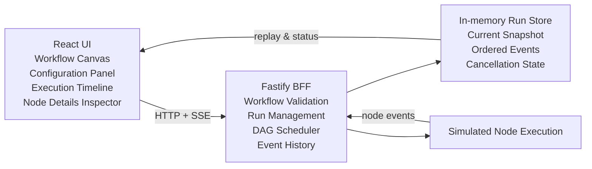

# FlowTrace

FlowTrace is a small workflow editor and execution inspector built with React + Vite on the frontend and Fastify on the backend. The implementation focuses on workflow editing, validation, a DAG-based scheduler, and event-driven execution visibility; it is intentionally an assessment-grade prototype rather than a production-grade orchestration platform.

## Stack

- React + TypeScript + Vite
- React Flow + Zustand
- Fastify + TypeScript + Zod
- Vitest

## Prerequisites

- Node.js 20+
- npm 10+

## Install dependencies

```bash
npm install
```

## Run the app

Start the API:

```bash
npm run dev:api
```

Start the web app:

```bash
npm run dev:web
```

The API listens on `http://localhost:3001` and the web app on the Vite default port (usually `http://localhost:5173`).

## Useful scripts

```bash
npm run build
npm run typecheck
npm run test
```

## Architecture

### Implemented behavior

1. Frontend components and responsibilities

   The web app is organized around a single FlowTrace studio shell. `App.tsx` composes the toolbar, canvas, inspector, and timeline and owns the app-level orchestration for run creation, run cancellation, import/export, and sample loading. The graph editing state lives in `useGraphStore`, while execution state lives in `useExecutionStore`.

   The canvas uses React Flow to render workflow nodes and edges. Each node is a `workflowNode` with input/transform/output styling, handles, and execution metadata. The left panel contains the node creation controls and the details inspector; the right panel contains the execution timeline. The footer shows a coarse run status label.

2. Workflow editing state versus execution state

   The editing model and execution model are intentionally separated.

   - `useGraphStore` stores editable graph state: nodes, edges, selected node and edge, validation messages, and connection rules. This state is the editor truth for what the user is building.
   - `useExecutionStore` stores run history and derived node state: current status, selected run id, ordered events, `lastSequence`, and `nodeStates`. This state is derived from execution events and is not used to drive graph editing.

   This separation matters because a workflow can be edited while a run is queued or running, and the UI must keep the graph authoring model distinct from the runtime model.

3. Workflow validation rules

   The API-side validation is enforced in `apps/api/src/workflow.ts` and is the source of truth for workflow integrity.

   Implemented checks include:

   - node and edge IDs must be non-empty and bounded
   - workflow node count is capped at `MAX_WORKFLOW_NODES` (currently 50)
   - duplicate node IDs are rejected
   - duplicate edges are rejected
   - edges cannot reference missing nodes
   - input nodes cannot accept incoming edges
   - output nodes cannot emit outgoing edges
   - directed cycles are rejected (`cycle-detected`)

   The validation result is returned as `{ valid, errors, warnings }` and is also enforced before creating a run. Validation is not treated as a UI-only concern; the create-run endpoint rejects invalid workflows before execution starts.

4. Backend API contract

   The Fastify BFF exposes the following implemented API surface.

   - `GET /health` returns service metadata and timestamp.
   - `POST /workflows/validate` validates a workflow payload and returns the validation result.
   - `POST /runs` creates a queued run from a workflow; it validates the workflow first.
   - `GET /runs` lists runs with id, status, workflowId, and updatedAt.
   - `GET /runs/:id` returns the current snapshot for a run.
   - `GET /runs/:id/events` returns events after a cursor, plus the next cursor and total event count.
   - `GET /runs/:id/stream` opens a Server-Sent Events stream that emits `run` events with event IDs and payloads.
   - `POST /runs/:id/cancel` cancels the run and returns the updated snapshot.

   The same run snapshot structure is used across API responses and SSE data.

5. DAG execution model

   Execution is modeled as a DAG scheduler in `apps/api/src/scheduler.ts`.

   The scheduler does the following:

   - builds `incoming` and `outgoing` adjacency maps from workflow edges
   - treats every node as initially `queued`
   - schedules only ready nodes whose dependencies are already `succeeded`
   - runs up to `maxConcurrency` nodes at once (currently default `2`)
   - records `node-started`, `node-succeeded`, `node-failed`, and `node-skipped` events
   - marks a run as `succeeded` only when all nodes are terminal and successful
   - marks a run as `failed` when a node fails or a non-successful terminal condition is reached

   The scheduler is intentionally not a general-purpose workflow engine. It is a small DAG runner with simulated node execution and dependency-aware progression.

6. Concurrency and failure propagation

   The scheduler uses in-flight promise tracking plus per-node `AbortController` instances. This gives two key behaviors:

   - nodes run concurrently up to the configured concurrency limit
   - cancellation aborts in-flight execution and stops queued progression

   Propagation is implemented directly in the scheduler:

   - failed dependencies trigger `shouldSkipNode(...)`
   - nodes with failed upstream dependencies are marked `skipped`
   - downstream nodes are not executed if their dependency chain is blocked

   This is a practical, deterministic failure model for a small assessment workflow engine, not a distributed orchestration system.

7. SSE event structure and sequence numbers

   The server normalizes event ordering in `createApp` and assigns a sequence number when missing. The event stream writes SSE frames like:

   ```text
   id: 12
   event: run
   data: { ...event, runId: "run-123" }
   ```

   The implemented event types are:

   - `run-created`
   - `run-started`
   - `node-started`
   - `node-succeeded`
   - `node-failed`
   - `node-skipped`
   - `run-terminal`
   - `run-cancelled`

   Sequence numbers are monotonic per run and are used to support cursor-based replay. The API also keeps a capped event history (`MAX_EVENT_HISTORY = 1000`) and drops older events from the in-memory store.

8. Snapshot and replay behavior

   Runs are stored in memory in the Fastify app with a `Map<string, RunSnapshot>`. A run snapshot contains the workflow, status, timestamps, and ordered events.

   The client-side execution store rebuilds node state from the event stream and replays only newer events. It rejects stale event sequences and deduplicates by sequence or id before updating UI state. This allows the app to recover from reconnects and event replay without mixing old and new run data.

   In the current implementation, replay is best-effort and in-memory only. It is not persisted across process restarts.

9. Cancellation semantics

   Cancellation is implemented in both the API and the UI.

   - The API `cancelRun(...)` writes a terminal cancelled event and marks the run status as `cancelled`.
   - The scheduler’s `cancel()` method sets a cancel flag and aborts all active node controllers.
   - In the UI, clicking Cancel emits a `run-cancelled` event and updates the execution status to `cancelled`.

   The important guardrail is that the system treats cancellation as a terminal state for the run, and downstream execution stops once the run is cancelled.

10. The Execution Inspector and how it consumes execution events

   The Execution Inspector is a read-through view over the execution stream.

   `useExecutionStore` converts incoming events into `nodeStates`. For each node, the state tracks:

   - status (`queued`, `running`, `succeeded`, `failed`, `skipped`, `cancelled`)
   - startedAt / finishedAt
   - durationMs
   - output payload
   - error or skip reason

   The timeline component renders the ordered event list and allows selecting an event; the inspector panel then surfaces the selected node execution details. This lets the user answer: what happened, in what order, and why a node was skipped or failed.

11. Current limitations

   The current implementation is intentionally narrow and has several clear limits:

   - execution state is in-memory only and does not survive a process restart
   - there is no multi-instance coordination or shared run store
   - there is no durable event log or long-term audit trail
   - there is no auth, access control, or per-user run isolation
   - there is no distributed scheduling, retry queue, or task orchestration backend
   - the workflow graph is still editor-first rather than production workflow orchestration

   These are not hidden assumptions; they are explicit trade-offs for the assessment scope.

12. What would change for 500-node workflows, multiplayer editing, and durable execution

   The current system is deliberately small and monolithic. Scaling it would require changes in several layers:

   - For 500-node workflows: reduce per-render cost, batch event updates, avoid expensive full-store recomputation, and likely move the scheduler and event stream to a more explicit queueing model.
   - For multiplayer editing: introduce optimistic locking, per-user session state, and a server-authoritative graph model; the current Zustand-based local graph store is not designed for collaborative conflict resolution.
   - For durable execution: persist runs and events to a database, add process recovery and replay from the event log, and make cancellation and retries durable across restarts.

   These are future improvements, not implemented behaviors.

### Architecture diagram



### Important trade-offs

The most important trade-off in the current implementation is the choice to keep execution state simple and local. This makes debugging and UI behavior easy to reason about, but it means the system is not durable, multi-instance, or production-safe. The graph editor and the scheduler are intentionally decoupled, which keeps the UI understandable but also makes the system less capable of representing full workflow orchestration semantics.

### Future improvements vs. implemented behavior

Implemented behavior:

- workflow authoring in a local React Flow canvas
- validation and cycle prevention at the API boundary
- DAG execution with dependency-aware skipping
- in-memory run snapshots and event replay
- SSE event streaming and timeline inspection
- cancel semantics for in-flight runs

Future improvements, not in the current implementation:

- durable storage and recovery
- multi-instance coordination and distributed scheduling
- multiplayer workflow editing with conflict resolution
- measured scale testing for large graphs and high concurrency
- production-grade security, auditing, and operational tooling

This architecture is intentionally small, inspectable, and easy to discuss in an interview because it reflects the behaviors that are implemented today, without overstating the maturity of the system.
