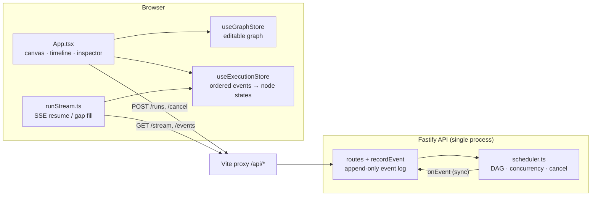

# FlowTrace

## 1. Overview

FlowTrace is a visual workflow editor with a live **Execution Inspector**. You build a DAG of input, transform and output nodes in the browser. A Fastify backend validates it and runs it on a real dependency-aware scheduler, and every execution event streams back over Server-Sent Events (SSE). The canvas, the timeline and the node inspector all show the same answers: what ran, what is running, what succeeded, what failed, why a node was skipped, and what a cancellation stopped.

Node execution is **simulated**. Each node takes 0.5–3 s and fails at random 10% of the time. This is an assessment-scope prototype, not a production orchestrator. [ARCHITECTURE.md](ARCHITECTURE.md) covers the design in depth, and [AI_NOTES.md](AI_NOTES.md) covers how AI assistance was used and checked.

## 2. Key features

- **Graph editor** (React Flow). Connection rules are enforced as you edit: no cycles, no edges into inputs, no edges out of outputs. Import and export as JSON, plus a sample workflow with two parallel branches.
- **Server-side validation.** The same rules, plus schema checks, are enforced again by the API. Errors name the offending node.
- **Real DAG execution.** Independent ready nodes run concurrently (up to 2 at a time). Dependents wait for every prerequisite. A failure skips only the nodes that depend on it, and the other branches finish.
- **Distinct outcomes for every node:** Queued, Running, Succeeded, Failed (with error), Skipped (with the upstream cause), Interrupted (cancelled while running), and Not started (cancelled before it ran).
- **Live streaming** with ordered, sequenced events. Reconnects resume from the last applied event, without gaps or duplicates.
- **Cancellation** that stops new work immediately and records an outcome for every unfinished node.

## 3. Prerequisites

- Node.js 20+ (verified with Node.js 24.19)
- npm 10+

## 4. Installation

```bash
npm install
```

## 5. Running the app

In two terminals, from the repository root:

```bash
npm run dev:api   # Fastify API on http://localhost:3001
npm run dev:web   # Vite on http://localhost:5173 (or the next free port)
```

Open the URL Vite prints. The browser only talks to the web origin. The frontend calls `/api/*`, and the Vite proxy (`apps/web/vite.config.ts`) forwards those requests to `http://127.0.0.1:3001` with the prefix removed, so no CORS is needed. `vite preview` uses the same proxy. To point the proxy at a different API, set `FLOWTRACE_API_TARGET`.

## 6. Testing

```bash
npm run test       # Vitest: web (jsdom + node) and api suites
npm run typecheck  # tsc --noEmit for both apps
npm run build      # vite build (web) + tsc (api)
```

Results from the final pass: web 34/34 tests in 9 files, API 30/30 tests in 3 files. Typecheck and build both exit 0.

| Area | Evidence |
|---|---|
| Validation: cycles, invalid edges, duplicates, readable errors | `workflow.test.ts`, `index.test.ts` |
| Ordering, concurrency, failure isolation, transitive skips, cancellation, one terminal event, the shipped sample | `scheduler.test.ts` (controlled executor; no timing dependence) |
| Live recording, SSE ordering, replay via `?after` and `Last-Event-ID`, cancel, disconnect | `index.test.ts` (real HTTP server) |
| Client resume, retry, gap fill, connection state | `runStream.test.ts` |
| Store updates, cursor reset between runs, cancel outcomes | `executionStore.test.ts`, `executionStatus.test.ts` |
| Canvas, timeline and inspector rendering | `WorkflowNode.test.tsx`, `ExecutionTimeline.test.tsx`, `NodeInspectorPanel.test.tsx` |
| `/api` proxy routing, error pass-through, unbuffered SSE | `vite.proxy.test.ts` (real Vite dev server) |

**Browser verification.** During the final pass, the real UI was driven in headless Chrome over the DevTools protocol, against the real Vite dev server and the real API. The checks were:

- loading the sample and running it to completion, with both branches visibly running concurrently;
- a run with a failure, where only the failed branch's output was skipped and the inspector showed the error;
- cancelling while both branches were running, which showed them as Interrupted, the outputs as Not started, and nothing new afterwards;
- an empty-canvas run message;
- dropping the API connection mid-run (by killing a TCP relay in front of the API). The UI showed "Reconnecting…", replayed the six events it had missed, and finished with no duplicates.

No console errors or warnings appeared. The driver script was a throwaway and is not part of the repository's test suite.

## 7. Architecture summary



- **Editing state** (`useGraphStore`) and **execution state** (`useExecutionStore`) are separate stores. A run executes the copy of the graph that was sent when it started.
- **The event log is the source of truth.** The server assigns each event a sequence number once. The client folds events into node states through a single function, used for both snapshots and live events. `executionStatus.ts` is the one mapping from node state to the label shown on the canvas, the timeline and the inspector.

## 8. API contract

The API serves these routes at its root. The browser reaches them as `/api/<route>`.

| Route | Behavior |
|---|---|
| `GET /health` | Service name and timestamp |
| `POST /workflows/validate` | `{ valid, errors, warnings }`; 400 if invalid |
| `POST /runs` | `{ workflow, metadata? }`. Validates, creates a run with a unique id, and starts the scheduler. Returns 201 with the live snapshot. Returns 400 `{ error }` with readable messages, for example `node "enrich-request" config.label: …` |
| `GET /runs` | Run summaries |
| `GET /runs/:id` | Full snapshot including the event log; 404 if unknown |
| `GET /runs/:id/events?after=N` | Events with sequence > N, plus `nextCursor`, `status`, `total` |
| `GET /runs/:id/stream?after=N` | SSE. Replays events after N (or after `Last-Event-ID`), then pushes live. Closes after the terminal event. |
| `POST /runs/:id/cancel` | `{ reason? }`. Returns `{ run, cancelled: true }`. For a finished run it returns `cancelled: false` and changes nothing. |

**Event types:**

| Event | Meaning |
|---|---|
| `run-created` | The run was created (sequence 1) |
| `run-started` | The scheduler started |
| `node-started` | A node began executing |
| `node-succeeded` | A node finished successfully |
| `node-failed` | A node failed; carries `reason` |
| `node-skipped` | A node will not run because an upstream node failed or was skipped; carries `reason` |
| `node-cancelled` | The run was cancelled; carries `interrupted` (true if the node was running) and `reason` |
| `run-terminal` | The run ended with `status` `succeeded`, `failed` or `cancelled` |

`run-cancelled` exists in the schema but is never emitted.

## 9. Execution semantics

- A node starts only when **all** of its prerequisites have succeeded, and only while fewer than 2 nodes are running. The concurrency limit is fixed on the server.
- When a node fails, every node downstream of it is skipped immediately, transitively, with a reason such as `Upstream node "Enrich Request" failed.` This happens even if a dependent is also waiting on another branch.
- **A failure never stops independent branches.** The run continues until every in-flight node settles, then ends `failed`. It ends `succeeded` only if every node succeeded.
- Every run emits exactly one `run-terminal` event, and it is the last event.
- **Configuration is not evaluated.** The inspector edits each node's label and description; both are sent with the run (label ≤ 80 characters, description ≤ 250). Type-specific config is filled with fixed defaults. Edge labels and comments are annotations only: **every connection always runs**, and there is no conditional branching. The UI says so in the inspector.

## 10. Cancellation behavior

`POST /runs/:id/cancel` calls `scheduler.cancel()`, which synchronously, before the response is sent:

- emits `node-cancelled` with `interrupted: true` for each running node, and aborts its `AbortSignal`;
- emits `node-cancelled` with `interrupted: false` for each node that had not started;
- emits `run-terminal: cancelled`.

After that, no node starts, and late executor results are ignored. The UI shows **Interrupted** and **Not started**, which are distinct from dependency **Skipped**.

**Limit:** cancellation is cooperative. The built-in simulated executor stops as soon as it is aborted (tested). A custom executor that ignores `AbortSignal` keeps running until it returns, and its result is then discarded.

## 11. SSE and reconnect behavior

- **Server.** Sequences are assigned once and are contiguous per run. The stream subscribes to new events before replaying old ones, synchronously, so nothing falls in between. Disconnected clients are unsubscribed (verified by code inspection, not by a test). The scheduler keeps running when the browser disconnects (tested).
- **Client** (`followRunStream`):
  - Each connection opens `/stream?after=<last applied sequence>`, reading the cursor from the store.
  - After a drop or error it retries with backoff of 0.5 s, 1 s, 2 s, 4 s, then 5 s, and shows "Connection to the run lost. Reconnecting…" in the status bar.
  - If an event arrives ahead of the cursor, the missing range is fetched from `/events` first.
  - The store ignores events at or below its cursor, and events from other runs.
  - A new run replaces the cursor.
  - If the server returns 404 for the run, the client stops and shows an error.
- **Retention.** Each run keeps up to 1,000 events. That is unreachable at the 50-node limit (at most 103 events), so replay always covers the whole run.

## 12. Known limitations

- **Simulated execution:** no data flows between nodes, and configuration and branch labels do not affect execution.
- **In-memory, single process:** runs are lost on API restart, and finished runs are never evicted. There are no multiple instances, no auth, and no durable audit log.
- **Page reload loses the run:** the run id is not in the URL and there is no run picker. Recovery after a reload is not supported. (The run continues on the server.)
- **Client retries indefinitely** while the API is unreachable. Recovery replays events rather than fetching a snapshot.
- **Cooperative cancellation** ([§10](#10-cancellation-behavior)).
- **Hosting:** the browser reaches the API only through the `/api` proxy (Vite dev or preview). Any other host must route `/api/*` the same way. The API sends no CORS headers.
- **Fixed concurrency:** the limit of 2 is not configurable. The 50-node limit is not load-tested.

## 13. Design trade-offs

| Choice | Benefit | Cost |
|---|---|---|
| Scheduler emits events synchronously; the server assigns sequences | One writer, so cursors are stable and ordering is trivial | Scheduler and API share a process; there is no queue |
| A failure skips dependents and does not abort the run | Independent work finishes; each skip shows its cause | A failed run lasts as long as its slowest branch |
| Recovery replays events rather than fetching snapshots | One code path for live updates and recovery | A long run would need a compact snapshot |
| `fetch` stream instead of `EventSource` | Explicit cursor, backoff, abort and gap handling | Reconnection is hand-written |
| Same-origin `/api` proxy instead of CORS | No API change; the dev and preview setup just works | Production hosting must provide the same routing |

## 14. With another week

1. Put the run id in the URL and add a run list, so a reload or a second tab can reattach through snapshot plus replay.
2. Make concurrency configurable, and add per-node timeouts and an "abandoned" outcome for executors that ignore cancellation.
3. Persist the event log (SQLite) behind `recordEvent`, and recover or fail interrupted runs on startup.
4. Add type-specific configuration editors once there is an executor that evaluates them, and conditional edges only with real semantics.
5. Add a committed Playwright smoke test for the browser flows verified manually in this pass.
